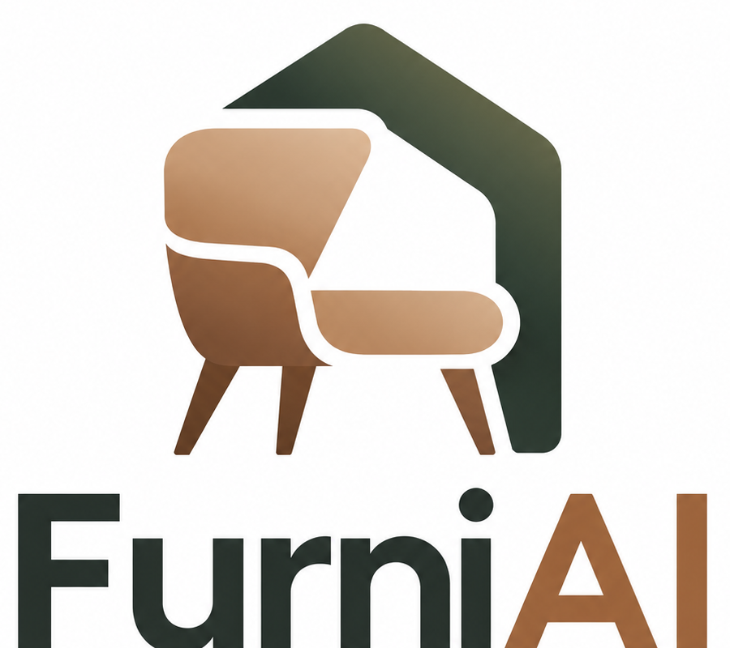

# FurniAI

> AI-assisted furniture discovery and commerce, built around explainable search and authoritative business workflows.



## Project overview

FurniAI is a full-stack furniture commerce application designed around a practical question: how can an AI assistant make shopping more useful without becoming the system of record?

The platform lets a shopper describe what they want in natural language, discover ranked products, understand why those products were recommended, ask questions grounded in product knowledge, manage a cart, and complete a controlled checkout flow. The interface is conversational where it adds value, while catalog, inventory, pricing, and order state remain governed by backend business logic.

This project is implemented as a modular monolith. That keeps the domain in one deployable system while preserving clear boundaries between the web experience, API layer, application services, persistence, search, and AI orchestration.

## What the system demonstrates

| Area | Implementation focus |
| --- | --- |
| Product discovery | Lexical, semantic, and hybrid search over the furniture catalog |
| Explainability | Search results expose the individual ranking signals behind the final score |
| Product intelligence | RAG-style retrieval over product-specific knowledge chunks |
| AI orchestration | LangGraph agent with structured state and constrained backend tools |
| Commerce | Users, carts, inventory, warehouses, reservations, orders, and shipments |
| Reliability | PostgreSQL authority, Redis caching, idempotency support, and request metadata |
| Frontend | React and TypeScript storefront with search, product, cart, and order experiences |

## Architecture

```text
┌──────────────────────────────┐
│ React + TypeScript storefront│
└──────────────┬───────────────┘
               │ HTTP / JSON
┌──────────────▼───────────────┐
│ FastAPI modular monolith     │
│  API routes                  │
│  Application services        │
│  Deterministic search        │
│  LangGraph agent + tools     │
└───────┬──────────┬───────────┘
        │          │
┌───────▼──────┐ ┌─▼──────────────┐
│ PostgreSQL   │ │ Redis          │
│ + pgvector   │ │ cache/idempot. │
└──────────────┘ └────────────────┘
```

PostgreSQL is the authoritative store for business data. Redis is deliberately limited to supporting concerns such as caching and idempotency. The language model does not directly access the database; it requests structured tool operations, and the application services validate and execute them.

## Main user journey

1. A shopper describes a need such as a wooden study desk for a compact room.
2. The backend runs lexical and semantic retrieval against the catalog.
3. A deterministic Python ranker combines the retrieval signals with rating and price preference.
4. The UI presents the products and the score breakdown, making the result inspectable.
5. Product knowledge retrieval supplies grounded answers about care, materials, dimensions, and usage.
6. Cart, inventory, warehouse, and order services handle the transaction through normal backend rules.
7. Checkout is approval-aware and protected against duplicate requests with idempotency support.

## Explainable hybrid ranking

The final ranking is intentionally deterministic rather than delegated to the LLM:

```text
final score =
    0.50 × semantic similarity
  + 0.20 × keyword relevance
  + 0.15 × normalized rating
  + 0.15 × price preference
```

This makes the system easier to test, tune, and explain. The frontend can display the component scores, while the backend remains responsible for the final ordering.

## AI assistant design

The assistant uses LangGraph to manage conversation state, tool calls, and human approval. Its available capabilities are deliberately narrow:

- search products
- compare products
- retrieve product knowledge
- check inventory and delivery information
- request checkout after approval

The agent is an orchestration layer, not a business authority. Product availability, prices, inventory reservations, and order creation are resolved by backend services and the database.

## Technology stack

- **Frontend:** React, TypeScript, Vite
- **API:** Python, FastAPI, Pydantic
- **Persistence:** PostgreSQL, SQLAlchemy, Alembic
- **Vector retrieval:** pgvector and sentence-transformer embeddings
- **Cache and reliability:** Redis
- **AI workflow:** LangGraph and Groq-compatible LLM integration
- **Operations:** Docker Compose, request IDs, response timing headers
- **Testing:** Pytest, deterministic ranking tests, integration coverage

## Repository structure

```text
backend/app/api/          HTTP route handlers
backend/app/services/     catalog, cart, order, user, and warehouse logic
backend/app/agent/        graph state, tools, prompts, and agent execution
backend/app/models/       SQLAlchemy persistence models
backend/app/schemas/      request and response contracts
backend/alembic/          database migration history
backend/scripts/          data generation, seeding, and search utilities
backend/tests/            ranking, concurrency, and integration tests
frontend/src/components/  navigation, assistant, and score UI
frontend/src/pages/       home, search, product, cart, and order views
frontend/src/services/    typed frontend API client
docker-compose.yml        PostgreSQL, Redis, backend, and frontend services
```

## API surface

The backend exposes interactive OpenAPI documentation and the following core capabilities:

| Capability | Route |
| --- | --- |
| Service and database health | `GET /`, `GET /health/db` |
| Catalog and product detail | `GET /products/`, `GET /products/{id}` |
| Lexical search | `GET /products/search` |
| Semantic search | `GET /products/semantic-search` |
| Explainable hybrid search | `GET /products/hybrid-search` |
| Product knowledge retrieval | `GET /products/{id}/knowledge` |
| AI shopping assistant | `POST /agent/chat` |
| Users, cart, and checkout | `/users/*`, `/cart/*`, `/orders/*` |

## Engineering decisions

FurniAI intentionally uses a modular monolith instead of microservices. The goal is to demonstrate strong domain boundaries without introducing distributed-system overhead before it is needed.

The project also intentionally avoids direct LLM database access, opaque recommendation decisions, custom model training, Kafka-style event infrastructure, Kubernetes, and external payment or logistics integrations. These boundaries keep the system explainable and make correctness testable.

## Current status

Implemented:

- React storefront with product discovery, detail, cart, and order views
- FastAPI catalog, user, cart, and order APIs
- PostgreSQL schema with Alembic migrations
- Lexical, semantic, and hybrid search
- Product knowledge retrieval with vector similarity
- LangGraph assistant with approval-aware checkout
- Redis caching and idempotency support
- Ranking, concurrency, and integration test coverage
- Docker Compose development environment


